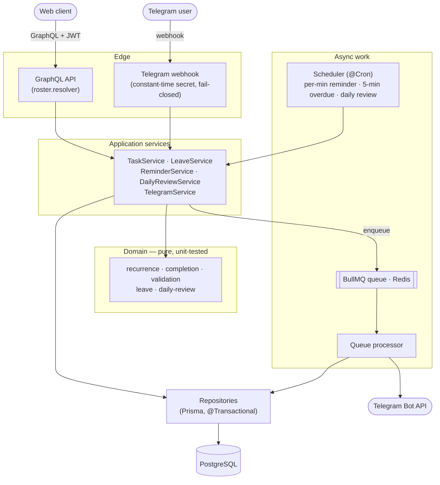

# Roster

[](https://github.com/kiresakura/roster-server/actions/workflows/ci.yml)

**English** · [繁體中文](./README.zh-TW.md)

> **Team task reminders in Telegram — no admin dashboard to babysit.**
> Members get each task in Telegram, report it done with one tap, and approved
> leave silences their reminders automatically.

Roster is a NestJS backend (GraphQL API + Telegram bot) for small teams. A
supervisor sets up tasks once — including recurring ones like a weekday
stand-up or "last Friday of the month" — and Roster reminds each assignee ahead
of time, tracks who has reported, and handles leave requests.

```
Supervisor ──creates──▶  Task (recurring, multi-assignee, importance)
                              │
                   scheduler scans every minute
                              │  enqueues per-user reminder jobs (lead-time aware,
                              ▼  skipped while the assignee is on approved leave)
   Member's Telegram  ◀──────┘   "❗ Important: Stand-up  [✅ Mark complete]"
        │ taps button
        ▼
   Assignment COMPLETED ──▶ ANY mode: task done, peers told to stand down
                            ALL mode: task done once everyone has reported
```

## Features

- **Tasks and reminders** — a `TASK` has a completion lifecycle; a `REMINDER`
  only notifies. Either can be flagged `importance`.
- **Recurrence** — weekly on chosen weekdays, monthly on a date (months without
  that day are skipped), or monthly on the *n*-th or last weekday, with an
  optional `until`. Every occurrence keeps the start's clock time.
- **Multi-assignee completion** — `ANY`: the first report closes the task and
  peers who had not started are told to stand down. `ALL`: the task closes once
  every assignee has reported.
- **Leave** — members apply, supervisors approve or reject. Approved leave
  suppresses that member's reminders and drops those items from their daily
  review.
- **Telegram bot** — one-shot deep-link account binding, reminder pushes with a
  **✅ Mark complete** button on important tasks, a daily review, and a
  supervisor alert when an important task goes overdue.
- **Scheduling** — a per-minute reminder scan (per-user lead time, default 30
  minutes), a 5-minute overdue scan and a daily-review cron in a configurable
  timezone. Per-user work runs on a BullMQ queue; deterministic job ids guard
  against double-sends from overlapping scans.
- **GraphQL API** for tasks, completion, leave, preferences and Telegram
  binding, plus a minimal JWT login so the service runs standalone.

## Architecture



| Layer | Path | Responsibility |
|---|---|---|
| **Domain** (pure, framework-free) | `src/domain/` | Recurrence expansion, completion rules, leave overlap, validation, daily-review composition. No NestJS, no Prisma — **unit-tested in isolation**. |
| **Data** | `src/roster/*.repository.ts` | Prisma repositories over a transaction-aware client (`@Transactional()` via `nestjs-cls`). |
| **Services** | `src/roster/*.service.ts` | Orchestration: tasks, leave, Telegram, reminder scan, daily review. |
| **Edge** | `roster.resolver.ts`, `telegram-webhook.controller.ts` | GraphQL API + the Telegram webhook (constant-time secret check, fail-closed in production). |
| **Infra** | `src/{config,prisma,auth,queue}/` | Zod-validated config, Prisma, minimal JWT auth, BullMQ queue + scheduler. |

## Quickstart

Needs Node.js 20.12+ and Docker. No accounts or API keys.

```bash
git clone https://github.com/kiresakura/roster-server.git
cd roster-server

docker compose up -d       # Postgres 16 on :5432, Redis 7 on :6379
cp .env.example .env       # defaults match docker-compose
npm install
npm run prisma:deploy      # create the schema
npm run db:seed            # demo team, tasks and leave (prints user ids)
npm run start:dev          # http://localhost:3010/graphql
```

The seed creates three accounts (password `password123` for all):

| Email | Role | Demo data |
|---|---|---|
| `supervisor@roster.local` | supervisor | creates the tasks, reviews leave |
| `member@roster.local` | member | has a **pending** leave request in 7 days |
| `leo@roster.local` | member | on **approved** leave tomorrow |

…and four tasks: a weekday **Morning stand-up** (`ANY`), an important one-off
**Submit the expense report** (`ANY`), a Friday **Weekly status report**
(`ALL`) and a **Monthly retro** reminder on the last Friday.

### Try it without Telegram

In a second terminal, define two small helpers (they only need `curl` and
`node`):

```bash
login() { curl -s localhost:3010/auth/login -H 'content-type: application/json' \
  -d "{\"email\":\"$1\",\"password\":\"password123\"}" | node -pe 'JSON.parse(require("fs").readFileSync(0)).accessToken'; }
gql() { curl -s localhost:3010/graphql -H 'content-type: application/json' -H "authorization: Bearer $1" \
  -d "$(node -e 'console.log(JSON.stringify({ query: process.argv[1] }))' "$2")"; echo; }

SAM=$(login supervisor@roster.local); MIA=$(login member@roster.local); LEO=$(login leo@roster.local)
```

```bash
# The seeded tasks
gql "$SAM" '{ tasks { id title type completionMode status } }'

# ALL mode: the weekly report stays OPEN until both members have reported
gql "$MIA" 'mutation { completeAssignment(taskId: "demo-status-report") { status } }'   # OPEN
gql "$LEO" 'mutation { completeAssignment(taskId: "demo-status-report") { status } }'   # COMPLETED

# ANY mode: the first report closes the expense report (Leo is queued a "stand down" note)
gql "$MIA" 'mutation { completeAssignment(taskId: "demo-expense-report") { status } }'  # COMPLETED

# Leave: the supervisor approves Mia's pending request
gql "$SAM" '{ pendingLeaveRequests { id userId reason } }'
gql "$SAM" 'mutation { approveLeave(id: "demo-leave-mia") { status } }'                 # APPROVED

# Create your own task (use a member id printed by the seed)
gql "$SAM" 'mutation { createTask(input: {
  title: "Ship the release", type: TASK, completionMode: ANY, importance: true,
  startAt: "2026-12-01T09:30:00Z",
  recurrence: { kind: WEEKLY, byWeekday: [1, 2, 3, 4, 5] },
  assigneeIds: ["<member-id>"] }) { id status } }'
```

**Where are the reminders?** The reminder, overdue and daily-review jobs only
run when Telegram is enabled, and reminders are only computed for members who
have bound a Telegram chat. There is no API that lists upcoming reminders; the
timing rules (lead time, leave suppression, recurring occurrences) are pinned by
unit tests that run offline:

```bash
npx vitest run test/reminder.service.spec.ts
```

## Connect Telegram

1. In Telegram, ask [@BotFather](https://t.me/BotFather) for `/newbot` and copy
   the bot token and username.
2. Generate a webhook secret with `openssl rand -hex 24`, then set in `.env`
   and restart `npm run start:dev`:

   ```ini
   TELEGRAM_ENABLED=true
   TELEGRAM_BOT_TOKEN=123456:AA...
   TELEGRAM_BOT_USERNAME=your_bot
   TELEGRAM_WEBHOOK_SECRET=<the generated secret>
   ```

3. Telegram delivers updates by webhook only, so expose port 3010 over HTTPS
   (any tunnel works, e.g. `cloudflared tunnel --url http://localhost:3010`)
   and register it:

   ```bash
   curl "https://api.telegram.org/bot<bot-token>/setWebhook" \
     -d "url=https://<public-host>/api/telegram/webhook" \
     -d "secret_token=<the generated secret>"
   ```

4. Bind your account: `gql "$MIA" 'mutation { startTelegramBind { deepLinkUrl } }'`,
   open the link and press **Start**. The bot replies "✅ Bound".
5. See a reminder within a few minutes — set your lead time to one minute and
   create an important task for yourself that starts three minutes from now:

   ```bash
   gql "$MIA" 'mutation { updateReminderLeadMinutes(minutes: 1) { reminderLeadMinutes } }'
   ME=$(gql "$MIA" '{ myPreferences { userId } }' | node -pe 'JSON.parse(require("fs").readFileSync(0)).data.myPreferences.userId')
   START=$(node -p 'new Date(Date.now() + 3 * 60e3).toISOString()')
   gql "$MIA" "mutation { createTask(input: { title: \"Try Roster\", type: TASK, completionMode: ANY,
     importance: true, startAt: \"$START\", assigneeIds: [\"$ME\"] }) { id } }"
   ```

   About two minutes later the bot sends "❗ Important: Try Roster" with a
   **✅ Mark complete** button; tapping it reports the task.

## Configuration

All settings are environment variables (see [`.env.example`](./.env.example));
a `.env` file in the working directory is loaded at startup, and variables
already set in the environment take precedence.

| Variable | Default | Purpose |
|---|---|---|
| `DATABASE_URL` | — (required) | PostgreSQL connection string |
| `REDIS_URL` | `redis://localhost:6379` | BullMQ queue |
| `PORT` | `3010` | HTTP port |
| `JWT_SECRET` | dev-only value | Signs the bundled login tokens |
| `TELEGRAM_ENABLED` | `false` | Turns on the bot and all scheduled pushes |
| `TELEGRAM_BOT_TOKEN` / `TELEGRAM_BOT_USERNAME` | empty | From @BotFather |
| `TELEGRAM_WEBHOOK_SECRET` | empty | Required in production; the webhook is rejected without it |
| `DAILY_REVIEW_CRON` / `DAILY_REVIEW_TIMEZONE` | `0 18 * * *` / `UTC` | When the daily review is sent |
| `TZ` | system | Recurrence clock times and the daily review's "today" use the server's local time |

## Testing and CI

```bash
npm test             # unit tests — no database, Redis or Telegram needed
npm run typecheck
npm run build
```

The 51 unit tests cover recurrence expansion, `ANY`/`ALL` completion,
input validation, leave windows, the daily review and overdue selection, the
reminder scan (built over in-memory fakes: lead times, leave suppression,
deterministic job ids), queue job ids that BullMQ accepts, GraphQL inputs
passing the global validation pipe, and `.env` loading.
[GitHub Actions](./.github/workflows/ci.yml) runs typecheck, tests and two
consecutive builds on every push to `main` and on pull requests.

## Known limitations

- Completion and overdue state are tracked per task, not per occurrence:
  completing a recurring task closes the whole series, and an important
  recurring task is flagged overdue (which stops its reminders) once its first
  start or due time passes unreported.
- The `SKIPPED_ON_LEAVE` assignment status exists in the schema, but nothing
  sets it yet; leave takes effect by suppressing reminders and daily-review
  items.
- Telegram is webhook-only (no long polling), so a public HTTPS URL is needed.
- GraphQL errors carry the service's message, but not its machine-readable
  code (`extensions.code` is `INTERNAL_SERVER_ERROR`).

## Tech stack

NestJS · GraphQL (Apollo, code-first) · Prisma + PostgreSQL · BullMQ + Redis ·
`@nestjs/schedule` · `nestjs-cls` transactions · Zod · Vitest · TypeScript.

## Origins

Roster began as a module I built on top of [AFFiNE](https://github.com/toeverything/AFFiNE)
for a self-hosted deployment. This repository is a **standalone reimplementation**
of that module — it contains none of AFFiNE's source; the domain logic, data
model, API, Telegram integration, and scheduling were re-homed into the clean,
dependency-light service you see here. See [`NOTICE.md`](./NOTICE.md).

## License

[MIT](./LICENSE).
