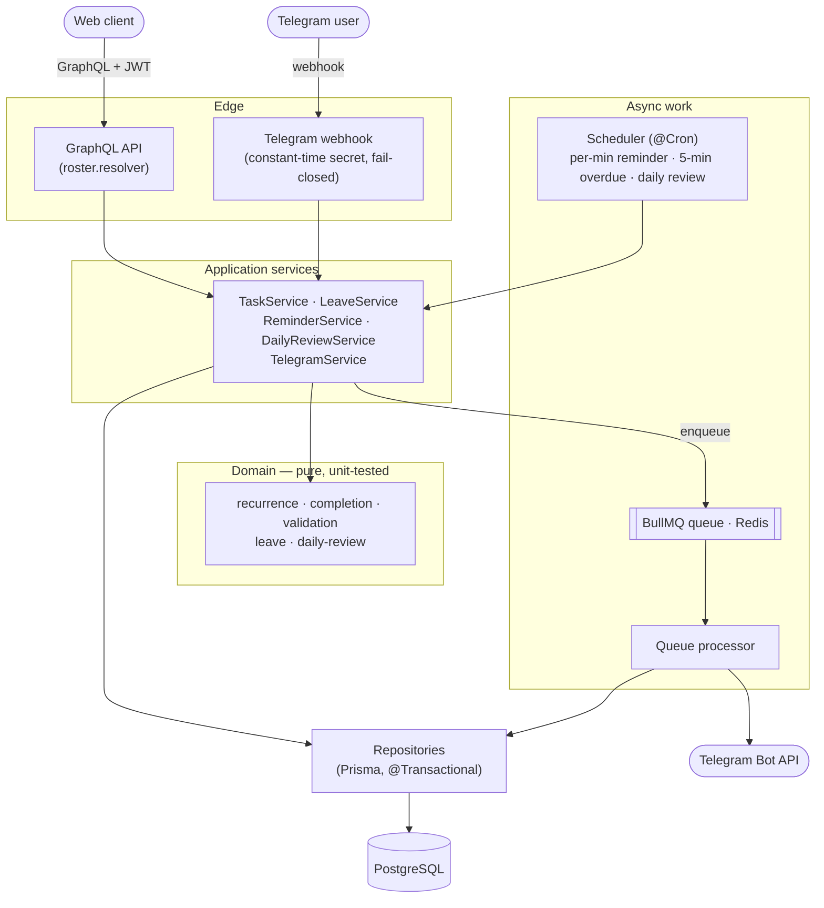

# Roster

[](https://github.com/kiresakura/roster-server/actions/workflows/ci.yml)

[English](./README.md) · **繁體中文**

> **小團隊不用開後台：用 Telegram 收任務提醒、一鍵回報完成、請假自動跳過提醒。**

Roster 是給小團隊用的 NestJS 後端（GraphQL API＋Telegram 機器人）。主管把任務設定一次——
包含「平日站會」或「每月最後一個週五」這類重複任務——Roster 就會在時間到之前提醒每位負責人、
記錄誰已回報完成，並處理請假申請。

```
主管 ──建立──▶  任務（可重複、多位負責人、重要標記）
                    │
          排程器每分鐘掃描一次
                    │  依每人提前量排入提醒工作
                    ▼  （負責人在已核准的假期內則跳過）
   成員的 Telegram ◀─┘   「❗ Important: Stand-up  [✅ Mark complete]」
        │ 按下按鈕
        ▼
   該成員回報完成 ──▶ ANY 模式：任務完成，通知其他人不用做了
                      ALL 模式：所有人都回報後任務才完成
```

## 功能

- **任務與提醒**：`TASK` 有完成流程；`REMINDER` 只負責通知。兩者都可標記 `importance`（重要）。
- **重複規則**：每週指定星期幾、每月固定日期（沒有該日的月份會跳過）、每月第 *n* 個或最後一個星期幾，
  可設 `until` 截止。每次重複都沿用起始時間的時刻。
- **多人完成語意**：`ANY` 任一人回報即完成，尚未開始的其他人會收到「不用做了」通知；
  `ALL` 要每位負責人都回報才完成。
- **請假**：成員申請、主管核准或駁回。核准後，該成員在假期內的提醒會被略過，每日回顧也不列入那些項目。
- **Telegram 機器人**：一次性 deep link 綁定帳號、提醒推播（重要任務附 **✅ Mark complete** 按鈕）、
  每日回顧，以及重要任務逾期時通知主管。
- **排程**：每分鐘掃描提醒（每人可設提前量，預設 30 分鐘）、每 5 分鐘掃描逾期、每日回顧 cron
  （時區可設定）。每人的工作交給 BullMQ 佇列處理，固定的 job id 可防止掃描重疊造成重複發送。
- **GraphQL API**：任務、回報完成、請假、偏好設定、Telegram 綁定；另附最小化的 JWT 登入，
  不需外部身分系統就能獨立執行。

## 架構



| 分層 | 路徑 | 職責 |
|---|---|---|
| **Domain**（純函式、不依賴框架） | `src/domain/` | 重複規則展開、完成規則、請假重疊判斷、輸入驗證、每日回顧訊息組裝。不碰 NestJS、Prisma，**可獨立單元測試**。 |
| **Data** | `src/roster/*.repository.ts` | 以支援交易的 client 包裝的 Prisma repository（`nestjs-cls` 的 `@Transactional()`）。 |
| **Services** | `src/roster/*.service.ts` | 流程協調：任務、請假、Telegram、提醒掃描、每日回顧。 |
| **Edge** | `roster.resolver.ts`、`telegram-webhook.controller.ts` | GraphQL API＋Telegram webhook（常數時間比對 secret，正式環境未設定則拒收）。 |
| **Infra** | `src/{config,prisma,auth,queue}/` | Zod 驗證的設定、Prisma、最小化 JWT 驗證、BullMQ 佇列與排程。 |

## 快速開始

需要 Node.js 20.12 以上與 Docker。不需要任何帳號或 API 金鑰。

```bash
git clone https://github.com/kiresakura/roster-server.git
cd roster-server

docker compose up -d       # Postgres 16（:5432）、Redis 7（:6379）
cp .env.example .env       # 預設值已對應 docker-compose
npm install
npm run prisma:deploy      # 建立資料表
npm run db:seed            # 示範團隊、任務與請假（會印出使用者 id）
npm run start:dev          # http://localhost:3010/graphql
```

seed 會建立三個帳號（密碼都是 `password123`）：

| Email | 角色 | 示範資料 |
|---|---|---|
| `supervisor@roster.local` | 主管 | 建立任務、審核請假 |
| `member@roster.local` | 成員 | 7 天後有一筆**待審**請假 |
| `leo@roster.local` | 成員 | 明天**已核准**請假 |

另有四個任務：平日 **Morning stand-up**（`ANY`）、重要的一次性 **Submit the expense report**（`ANY`）、
每週五 **Weekly status report**（`ALL`），以及每月最後一個週五的 **Monthly retro** 提醒。

### 不接 Telegram 直接試

開第二個終端機，定義兩個小工具（只需要 `curl` 與 `node`）：

```bash
login() { curl -s localhost:3010/auth/login -H 'content-type: application/json' \
  -d "{\"email\":\"$1\",\"password\":\"password123\"}" | node -pe 'JSON.parse(require("fs").readFileSync(0)).accessToken'; }
gql() { curl -s localhost:3010/graphql -H 'content-type: application/json' -H "authorization: Bearer $1" \
  -d "$(node -e 'console.log(JSON.stringify({ query: process.argv[1] }))' "$2")"; echo; }

SAM=$(login supervisor@roster.local); MIA=$(login member@roster.local); LEO=$(login leo@roster.local)
```

```bash
# seed 建立的任務
gql "$SAM" '{ tasks { id title type completionMode status } }'

# ALL 模式：兩位成員都回報前，週報維持 OPEN
gql "$MIA" 'mutation { completeAssignment(taskId: "demo-status-report") { status } }'   # OPEN
gql "$LEO" 'mutation { completeAssignment(taskId: "demo-status-report") { status } }'   # COMPLETED

# ANY 模式：第一個回報就完成報帳任務（並排入一則通知 Leo「不用做了」）
gql "$MIA" 'mutation { completeAssignment(taskId: "demo-expense-report") { status } }'  # COMPLETED

# 請假：主管核准 Mia 的待審申請
gql "$SAM" '{ pendingLeaveRequests { id userId reason } }'
gql "$SAM" 'mutation { approveLeave(id: "demo-leave-mia") { status } }'                 # APPROVED

# 自己建一個任務（<member-id> 換成 seed 印出的成員 id）
gql "$SAM" 'mutation { createTask(input: {
  title: "Ship the release", type: TASK, completionMode: ANY, importance: true,
  startAt: "2026-12-01T09:30:00Z",
  recurrence: { kind: WEEKLY, byWeekday: [1, 2, 3, 4, 5] },
  assigneeIds: ["<member-id>"] }) { id status } }'
```

**提醒在哪裡看？** 提醒、逾期與每日回顧排程只在啟用 Telegram 時執行，而且只會替已綁定 Telegram
的成員計算提醒。目前沒有列出「即將發送的提醒」的 API；提醒時機的規則（提前量、請假跳過、重複任務展開）
由可離線執行的單元測試固定下來：

```bash
npx vitest run test/reminder.service.spec.ts
```

## 接上 Telegram

1. 在 Telegram 找 [@BotFather](https://t.me/BotFather) 執行 `/newbot`，記下 bot token 與 username。
2. 用 `openssl rand -hex 24` 產生 webhook secret，寫進 `.env` 後重啟 `npm run start:dev`：

   ```ini
   TELEGRAM_ENABLED=true
   TELEGRAM_BOT_TOKEN=123456:AA...
   TELEGRAM_BOT_USERNAME=your_bot
   TELEGRAM_WEBHOOK_SECRET=<產生的 secret>
   ```

3. Telegram 只透過 webhook 送更新，所以要把 3010 port 以 HTTPS 對外開放（任何 tunnel 都可以，
   例如 `cloudflared tunnel --url http://localhost:3010`），再註冊 webhook：

   ```bash
   curl "https://api.telegram.org/bot<bot-token>/setWebhook" \
     -d "url=https://<public-host>/api/telegram/webhook" \
     -d "secret_token=<產生的 secret>"
   ```

4. 綁定帳號：`gql "$MIA" 'mutation { startTelegramBind { deepLinkUrl } }'`，打開連結按 **Start**，
   機器人會回覆「✅ Bound」。
5. 幾分鐘內看到提醒——把提前量設成 1 分鐘，再建一個 3 分鐘後開始、指派給自己的重要任務：

   ```bash
   gql "$MIA" 'mutation { updateReminderLeadMinutes(minutes: 1) { reminderLeadMinutes } }'
   ME=$(gql "$MIA" '{ myPreferences { userId } }' | node -pe 'JSON.parse(require("fs").readFileSync(0)).data.myPreferences.userId')
   START=$(node -p 'new Date(Date.now() + 3 * 60e3).toISOString()')
   gql "$MIA" "mutation { createTask(input: { title: \"Try Roster\", type: TASK, completionMode: ANY,
     importance: true, startAt: \"$START\", assigneeIds: [\"$ME\"] }) { id } }"
   ```

   約兩分鐘後機器人會送出「❗ Important: Try Roster」並附 **✅ Mark complete** 按鈕，按下即回報完成。

## 設定

所有設定都是環境變數（見 [`.env.example`](./.env.example)）。啟動時會載入工作目錄下的 `.env`，
已存在的環境變數優先。

| 變數 | 預設 | 用途 |
|---|---|---|
| `DATABASE_URL` | —（必填） | PostgreSQL 連線字串 |
| `REDIS_URL` | `redis://localhost:6379` | BullMQ 佇列 |
| `PORT` | `3010` | HTTP port |
| `JWT_SECRET` | 僅供開發的預設值 | 簽發內建登入的 token |
| `TELEGRAM_ENABLED` | `false` | 開啟機器人與所有排程推播 |
| `TELEGRAM_BOT_TOKEN` / `TELEGRAM_BOT_USERNAME` | 空 | 由 @BotFather 取得 |
| `TELEGRAM_WEBHOOK_SECRET` | 空 | 正式環境必填；未設定時 webhook 一律拒收 |
| `DAILY_REVIEW_CRON` / `DAILY_REVIEW_TIMEZONE` | `0 18 * * *` / `UTC` | 每日回顧的發送時間 |
| `TZ` | 系統時區 | 重複任務的時刻與每日回顧的「今天」都以伺服器本地時間計算 |

## 測試與 CI

```bash
npm test             # 單元測試，不需要資料庫、Redis 或 Telegram
npm run typecheck
npm run build
```

51 個單元測試涵蓋：重複規則展開、`ANY`/`ALL` 完成語意、輸入驗證、請假區間、每日回顧與逾期挑選、
提醒掃描（以記憶體假資料組裝：提前量、請假跳過、固定 job id）、BullMQ 可接受的佇列 job id、
GraphQL input 通過全域驗證 pipe，以及 `.env` 載入。
[GitHub Actions](./.github/workflows/ci.yml) 會在每次 push 到 `main` 與每個 pull request 時
執行 typecheck、測試，並連續建置兩次。

## 已知限制

- 完成與逾期狀態是以「任務」為單位，而不是每一次重複：回報完成重複任務會結束整個系列；
  重要的重複任務在第一次開始（或截止）時間過後仍未回報，就會被標成逾期（之後也不再提醒）。
- schema 裡有 `SKIPPED_ON_LEAVE` 這個指派狀態，但目前沒有程式會設定它；請假是透過略過提醒與
  每日回顧項目生效。
- Telegram 只支援 webhook（沒有 long polling），因此需要對外的 HTTPS 網址。
- GraphQL 錯誤只帶服務端的訊息，不帶機器可讀的錯誤碼（`extensions.code` 一律是 `INTERNAL_SERVER_ERROR`）。

## 技術棧

NestJS · GraphQL（Apollo、code-first）· Prisma + PostgreSQL · BullMQ + Redis ·
`@nestjs/schedule` · `nestjs-cls` 交易 · Zod · Vitest · TypeScript。

## 緣起

Roster 起初是我在 [AFFiNE](https://github.com/toeverything/AFFiNE) 上為自架部署開發的模組。
這個 repo 是該模組的**獨立重新實作**，不含任何 AFFiNE 原始碼；domain 邏輯、資料模型、API、
Telegram 整合與排程都搬進了這個乾淨、依賴精簡的服務。詳見 [`NOTICE.md`](./NOTICE.md)。

## 授權

[MIT](./LICENSE)。
